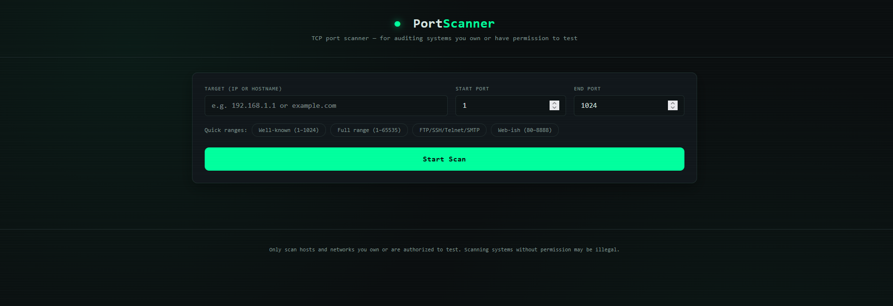
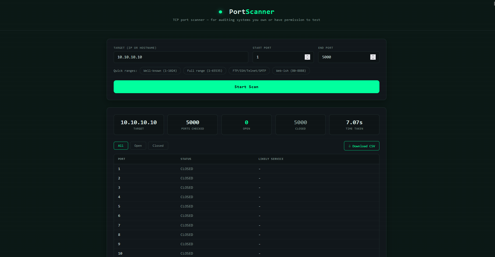
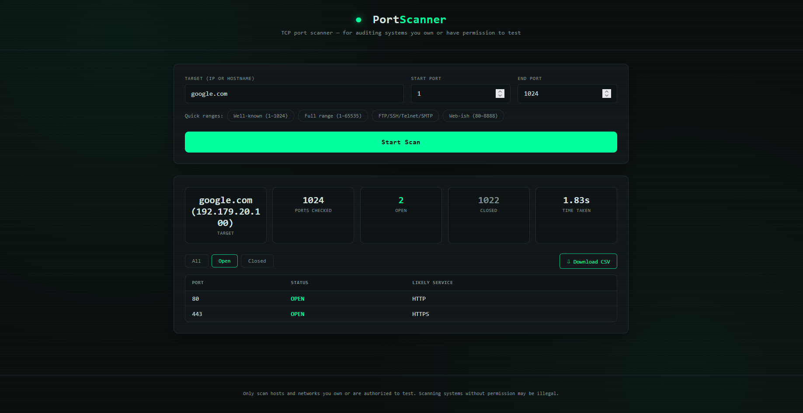
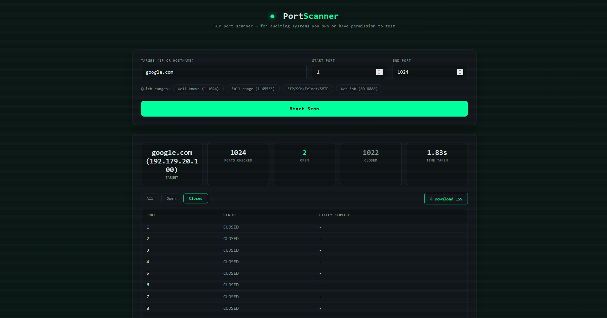
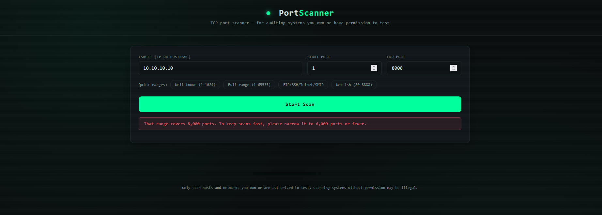

# 🔌 Port-Scanner-Flask 🛰️

A **Flask-based TCP Port Scanner Web App** that scans ports on an **IP address or hostname** using **multithreading**, shows **open/closed ports with their likely services**, and lets you **export the results to CSV**, right from your browser.
This web tool is built for **auditing systems you own or have permission to test**, **learning how port scanning works**, and **CTF/security practice**, combining a **fast multithreaded scanner** with a **clean, dark hacker-style web interface**.

---

## 🧱 Project Structure

```bash
port-scanner-flask/
│
├── assets/              # Screenshots + sample CSV output
├── core/                # Core scanning logic
│   ├── __init__.py
│   ├── config.py        # Timeout, worker limit, port cap & known services
│   ├── scanner.py       # Multithreaded port scanner
│   └── validators.py    # Target resolving & port range validation
├── static/              # Frontend assets
│   ├── app.js           # Form handling, filters & CSV download
│   └── style.css        # Dark terminal-style UI
├── templates/           # Flask templates
│   └── index.html       # Main web page
├── main.py              # Flask application
├── requirements.txt     # Project Dependencies
├── LICENSE              # Project license
└── README.md            # Project documentation
```

---

## ✨ Features

### 🔍 Port Scanning

- Scans **TCP ports** on an **IP address** or **hostname** (DNS is resolved automatically)
- Checks every port in its **own thread** using `ThreadPoolExecutor` — scans finish fast
- Reports each port as **open**, **closed**, **filtered**, or **error**
- Shows the **likely service** for every open port (e.g. `80 → HTTP`, `443 → HTTPS`)
- Displays **scan statistics**: target, ports checked, open count, closed count, and time taken

### 🧠 Service Detection

- Built-in map of **37 well-known services** (FTP, SSH, Telnet, SMTP, DNS, HTTP, HTTPS, SMB, RDP, MySQL, PostgreSQL, Redis, MongoDB, and more)
- Falls back to the system's service database (`socket.getservbyport`) for other ports
- Shows `Unknown` when no service name can be found

### 🌐 Web Interface

- Clean, dark **terminal-style UI** with scanline effect
- **Quick range presets** — Well-known (1–1024), Full range (1–65535), FTP/SSH/Telnet/SMTP (20–25), Web-ish (80–8888)
- **Filter buttons** — view **All**, **Open**, or **Closed** ports
- **Loading spinner** while a scan is running
- Friendly **error messages** for invalid input

### 📥 CSV Export

- **Download CSV** button exports the full result table (`Port, Status, Service`)
- File is auto-named after the scan, e.g. `portscan_google.com_1-1024.csv`

### 🛡️ Safety & Validation

- Ports must be whole numbers between **1 and 65535**
- Start port must be less than or equal to the end port
- **Safety cap of 6,000 ports per scan** so a scan can never hang forever
- Clear message when a hostname **cannot be resolved**

---

## 🛠 Technologies Used

| Technology             | Purpose                                          |
| ---------------------- | ------------------------------------------------ |
| **Python 3**           | Core language                                    |
| **Flask**              | Web framework & JSON API                         |
| **socket**             | TCP connection checks & hostname resolving       |
| **concurrent.futures** | Multithreaded scanning (`ThreadPoolExecutor`)    |
| **ipaddress**          | IP address validation                            |
| **HTML / CSS**         | Web page layout & dark theme                     |
| **JavaScript (Fetch)** | Form submit, filters, results table & CSV export |

---

## ▶️ How to Run

### 1️⃣ Clone the repository

```bash
git clone https://github.com/ShakalBhau0001/port-scanner-flask.git
```

### 2️⃣ Enter the project directory

```bash
cd port-scanner-flask
```

### 3️⃣ Install Dependencies

```bash
pip install flask
```

**OR**

```bash
pip install -r requirements.txt
```

### 4️⃣ Running the Project

```bash
python main.py
```

Then open your browser and visit:

```bash
http://127.0.0.1:5000
```

---

## ▶️ Usage

### 1. Enter a target

- Type an **IP address** (`192.168.1.1`) or a **hostname** (`example.com`)
- Set the **start port** and **end port** (default: `1` – `1024`), or click a **quick range** button

### 2. Start the scan

- Click **Start Scan** — the button shows a spinner while scanning

### 3. View & filter results

```bash
Target          Ports Checked     Open     Closed     Time Taken
google.com      1024              2        1022       1.83s
(192.179.20.100)

PORT     STATUS     LIKELY SERVICE
80       OPEN       HTTP
443      OPEN       HTTPS
```

### 4. Download results

- Click **Download CSV** to save the results

```bash
Port,Status,Service
1,closed,-
2,closed,-
...
80,open,HTTP
443,open,HTTPS
```

### 🔌 API Endpoint

The frontend talks to a single JSON endpoint, which you can also call directly:

```bash
POST /scan
Content-Type: application/json

{
  "target": "scanme.nmap.org",
  "start_port": 1,
  "end_port": 1024
}
```

```json
{
  "success": true,
  "target": "scanme.nmap.org",
  "resolved_ip": "45.33.32.156",
  "port_range": "1-1024",
  "stats": {
    "total_ports": 1024,
    "open_count": 2,
    "closed_count": 1022,
    "other_count": 0,
    "elapsed_seconds": 1.83
  },
  "results": [
    { "port": 22, "status": "open", "service": "SSH" },
    { "port": 80, "status": "open", "service": "HTTP" }
  ]
}
```

---

## 📁 Supported Input

- **Target:** IPv4 address or hostname
- **Port Range:** `1` – `65535` (max **6,000 ports** per scan)
- **Protocol:** TCP only
- **Output:** Results table in the browser + CSV download

> ⚠️ Only scan hosts and networks you **own** or are **authorized** to test. Scanning systems without permission may be illegal.

---

## ⚙️ How It Works

**1️⃣ Target Resolving & Validation**

- If the target is already a valid IP, no DNS lookup is needed
- Otherwise the hostname is resolved to an IP using `socket.gethostbyname`
- Port numbers and range size are validated before scanning starts

**2️⃣ Multithreaded Scanning**

- A `ThreadPoolExecutor` creates up to **300 worker threads**
- Each worker tries a TCP connection (`connect_ex`) to one port with a **0.4 second timeout**
- Result `0` → port is **open**; any other result → **closed**; timeouts → **filtered**; socket errors → **error**

**3️⃣ Service Guessing**

- Open ports are matched against the built-in `KNOWN_SERVICES` map
- If not found, the system service database is checked, otherwise `Unknown`

**4️⃣ Results & Stats**

- Results are sorted by port number
- Open / closed / other counts and elapsed time are calculated
- The frontend renders the stats cards, filterable table, and builds the CSV in the browser

---

## ⚙️ Configuration

All limits can be changed in `core/config.py`:

| Setting              | Default    | Description                    |
| -------------------- | ---------- | ------------------------------ |
| `CONNECT_TIMEOUT`    | `0.4`      | Seconds to wait per port check |
| `MAX_WORKERS`        | `300`      | Maximum concurrent threads     |
| `MAX_PORTS_PER_SCAN` | `6000`     | Safety cap on ports per scan   |
| `KNOWN_SERVICES`     | 37 entries | Port → service name map        |

---

## ⚠️ Common Errors

- **"Please enter a target IP address or hostname."** → Target field is empty
- **"Could not resolve '<host>'"** → Hostname is misspelled or has no DNS record; try an IP address
- **"Ports must be whole numbers between 1 and 65535."** → Invalid or out-of-range port values
- **"The start port must be less than or equal to the end port."** → Start port is greater than end port
- **"That range covers N ports…"** → Range is larger than **6,000 ports**; narrow it down (this also applies to the **Full range** and **Web-ish** presets, which exceed the cap)
- **"Could not reach the server."** → Flask app is not running or the connection was lost
- **Slow scans or wrong results on busy networks** → Firewalls/rate limits can drop connections; adjust `CONNECT_TIMEOUT` and `MAX_WORKERS`

---

## 🌟 Future Enhancements

- Scan the full 1–65535 range in **chunks** (batching) instead of a hard cap
- **UDP** port scanning support
- **Banner grabbing** for more accurate service/version detection
- **IPv6** support
- Live **progress bar** while scanning
- Export results as **JSON** along with CSV
- Run with a production server (e.g. Gunicorn) and turn off Flask's `debug` mode

---

## ⚠️ Disclaimer

> This project is intended for **educational and learning purposes only**.

> _Port scanning systems you do not own or have explicit permission to test may be **illegal**. The author is not responsible for any misuse of this tool. Always get proper authorization before scanning any network or host._

---

## 📸 Preview

### 1. **Home Page**



### 2. **Scan Results**



### 3. **Open Ports Filter**



### 4. **Closed Ports Filter**



### 5. **Validation Error**



---

## 🪪 Author

> **Creator: Shakal Bhau**

> **GitHub: [ShakalBhau0001](https://github.com/ShakalBhau0001)**

---

## ⭐ Support

If you like this project, consider giving it a ⭐ on GitHub!

---
